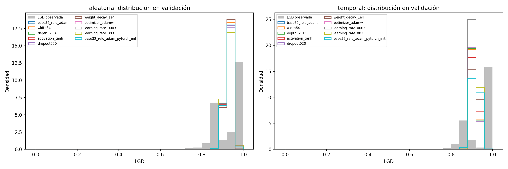

# Búsqueda exploratoria de hiperparámetros LGD

## Protocolo fijado antes de ejecutar

Esta búsqueda no usa la prueba. Utiliza la muestra `castigado=True` de `data/processed/lgd.parquet`, el `ColumnTransformer` ya guardado (29 columnas de entrada → 99 características), las máscaras `split_random`/`split_temporal` y las filas exactas ya evaluadas por Ridge. Se comprobará igualdad de IDs para entrenamiento, validación y prueba; en la prueba se validan únicamente IDs, sin calcular métricas ni usar objetivos/predicciones para selección.

### Candidatos e hipótesis

Nueve candidatos de `configs/mlp_lgd.yaml` usan salida sigmoide, MSE y `output_initialization: mean_train`; se añade un décimo contraste que solo modifica la inicialización de salida a PyTorch. La nueva variante está justificada por el piloto v2: `mean_train` produjo convergencia más rápida y un RMSE algo menor en las dos particiones, mientras que la magnitud es pequeña y el resultado temporal sigue cerca de la referencia constante. Los candidatos se explican así:

| ID | Diferencia respecto de la base | Hipótesis que pone a prueba |
|---|---|---|
| `base32_relu_adam` | Base: 99→32→1, ReLU, Adam, lr 0,001; inicialización `mean_train` | Referencia interna; una salida inicial constante puede acelerar el ajuste. |
| `width64` | 32 a 64 unidades | Más anchura puede capturar no linealidades, con más parámetros y riesgo de sobreajuste. |
| `depth32_16` | Una capa a dos (32,16) | Más profundidad puede aprender interacciones jerárquicas, aunque el ajuste puede complicarse. |
| `activation_tanh` | ReLU a tanh | Una activación acotada puede ayudar con características centradas; también puede saturar. |
| `dropout020` | Dropout 0 a 0,20 | Regularización estocástica puede mejorar generalización a costa de más ruido. |
| `weight_decay_1e4` | Decaimiento 0 a 1e−4 | Penalizar pesos puede reducir sobreajuste. |
| `optimizer_adamw` | Adam a AdamW, ambos con decay 1e−4 | AdamW separa decaimiento de pesos de la adaptación de gradiente. |
| `learning_rate_0003` | Tasa 0,001 a 0,0003 | Pasos más pequeños pueden refinar el mínimo, pero requieren más épocas. |
| `learning_rate_003` | Tasa 0,001 a 0,003 | Pasos más grandes pueden acelerar o volver inestable el aprendizaje. |
| `base32_relu_adam_pytorch_init` | Solo inicialización cambia a PyTorch frente a la base | Contraste emparejado que aísla el efecto de inicialización sugerido por el piloto. |

Se mantienen las dos semillas exploratorias 2026 y 2027, ambas fuera de las semillas finales 0–29. Son idénticas entre candidatos para permitir comparación emparejada. El número aumenta deliberadamente de 9 a **10 configuraciones** para contrastar inicialización sin confundirla con arquitectura u optimizador: 10×2 semillas×2 particiones=**40 ajustes**.

### Entrenamiento, elección y presupuesto

Cada ajuste usa MSE, batch 2.048, máximo **100 épocas**, paciencia **12** y `min_delta=0,00001`. El piloto v2 mostró que `mean_train` paraba entre 9 y 27 épocas, pero la inicialización PyTorch necesitó 62–70 épocas en su extensión con paciencia 8; 100/12 deja margen para tasas menores y variantes más complejas. `min_delta` solo controla paciencia; se guarda cada mínimo estricto del RMSE de validación y se verifica que el checkpoint corresponde al mínimo de la trayectoria.

La selección es independiente por partición: menor **media de RMSE de validación entre las dos semillas**. No se promedian aleatoria y temporal, y no se mezclan filas de otra partición. Se reportan MAE, RMSE, sesgo, R², media y distribución predicha, época, tiempo y parámetros; se leen las referencias Ridge y media de entrenamiento de las filas de validación ya guardadas. No se desempata con prueba.

Presupuesto previo: **30 minutos CPU total** con dos hilos. Es una estimación conservadora basada en el piloto (20 s por inicialización estándar hasta 60 épocas y 3–9 s con `mean_train`), extendida por el máximo de 100 épocas y el mayor ancho/profundidad. Si una fracción grande de corridas toca 100 épocas, se señalará que la comparación queda potencialmente truncada; solo entonces se considerará una extensión pequeña por validación, guardada en otro directorio.

El preprocesador compartido todavía se ajustó con entrenamiento aleatorio y pudo incorporar filas temporales de validación/prueba. La deriva de LGD (media observada 0,930 en validación aleatoria y 0,945 temporal; masa en uno 45,96 % y 62,72 %) no se atribuye a la red ni se corrige con la inicialización. Sigmoide+MSE estima una media condicional acotada, no la masa puntual de LGD=1.

Comando previsto, después de fijar el protocolo:

```powershell
.\.venv\Scripts\python.exe scripts/19_buscar_mlp_lgd.py --modo search
```

```bash
python scripts/19_buscar_mlp_lgd.py --modo search
```

## Ejecución y resultados

Comando de búsqueda:

```powershell
.\.venv\Scripts\python.exe scripts/19_buscar_mlp_lgd.py --modo search
```

Completó **40 ajustes en 515,35 s de pared / 510,74 s de entrenamiento** (8 min 35 s de pared), dentro de los 30 min previstos. Versiones y hashes quedan en `results/lgd_mlp_search_v1/resumen_busqueda.json`; métricas por semilla, checkpoints, predicciones validación, trayectorias y figuras quedan en esa carpeta y `models/lgd_mlp_search_v1/`. El pipeline comprobó los IDs contra Ridge en entrenamiento, validación y prueba; las predicciones y métricas que guardó son únicamente de validación. No calculó métricas de prueba ni la usó para seleccionar.

### Tabla completa de validación

Los valores son media ± desviación estándar entre las semillas 2026/2027, salvo sesgo y R², que se muestran como media. Tiempo es promedio de entrenamiento por corrida; parámetros son conteo entrenable. El CSV por corrida contiene todos los valores individuales, capas, inicialización, pérdida, parada, tiempo, media predicha/observada e hipótesis.

| Partición | Candidato | RMSE media ± DE | MAE media ± DE | Sesgo media ± DE | R² media ± DE | Parámetros | s/corrida | Épocas promedio |
|---|---|---:|---:|---:|---:|---:|---:|---:|
| Aleatoria | `base32_relu_adam` | **0,094325 ± 0,000022** | 0,071879 ± 0,000113 | −0,000129 ± 0,000308 | 0,023046 ± 0,000463 | 3.233 | 12,11 | 33,5 |
| Aleatoria | `width64` | 0,094376 ± 0,000075 | 0,071930 ± 0,000398 | +0,000204 ± 0,001202 | 0,021981 ± 0,001559 | 6.465 | 9,61 | 26,0 |
| Aleatoria | `depth32_16` | 0,094350 ± 0,000052 | 0,071766 ± 0,000389 | +0,000219 ± 0,001090 | 0,022509 ± 0,001073 | 3.745 | 9,61 | 26,0 |
| Aleatoria | `activation_tanh` | 0,094484 ± 0,000024 | 0,072261 ± 0,000043 | −0,001412 ± 0,000498 | 0,019749 ± 0,000490 | 3.233 | 26,00 | 71,0 |
| Aleatoria | `dropout020` | 0,094350 ± 0,000031 | 0,072117 ± 0,000045 | −0,000852 ± 0,000147 | 0,022514 ± 0,000633 | 3.233 | 14,92 | 39,0 |
| Aleatoria | `weight_decay_1e4` | 0,094414 ± 0,000002 | 0,072589 ± 0,000024 | −0,001326 ± 0,000166 | 0,021183 ± 0,000039 | 3.233 | 20,95 | 58,0 |
| Aleatoria | `optimizer_adamw` | 0,094328 ± 0,000024 | 0,071880 ± 0,000120 | −0,000126 ± 0,000333 | 0,022968 ± 0,000490 | 3.233 | 13,13 | 36,0 |
| Aleatoria | `learning_rate_0003` | 0,094346 ± 0,000009 | 0,072096 ± 0,000064 | −0,000981 ± 0,000065 | 0,022590 ± 0,000183 | 3.233 | 28,76 | 79,0 |
| Aleatoria | `learning_rate_003` | 0,094383 ± 0,000011 | 0,072275 ± 0,000081 | −0,001609 ± 0,000269 | 0,021839 ± 0,000236 | 3.233 | 7,54 | 20,0 |
| Aleatoria | `base32_relu_adam_pytorch_init` | 0,094544 ± 0,000124† | 0,072371 ± 0,000262† | −0,001024 ± 0,000370† | 0,018500 ± 0,002572† | 3.233 | 36,33 | 100,0† |
| Temporal | `base32_relu_adam` | 0,085739 ± 0,000039 | 0,076925 ± 0,000518 | −0,027718 ± 0,000002 | −0,116973 ± 0,001004 | 3.233 | 5,37 | 16,0 |
| Temporal | `width64` | 0,085724 ± 0,000047 | 0,076956 ± 0,000429 | −0,027736 ± 0,000033 | −0,116582 ± 0,001223 | 6.465 | 5,10 | 15,0 |
| Temporal | `depth32_16` | 0,085623 ± 0,000066 | 0,076843 ± 0,000609 | −0,027422 ± 0,000161 | −0,113966 ± 0,001711 | 3.745 | 5,14 | 15,5 |
| Temporal | `activation_tanh` | 0,085693 ± 0,000029 | 0,076923 ± 0,000404 | −0,027574 ± 0,000170 | −0,115779 ± 0,000764 | 3.233 | 4,98 | 15,0 |
| Temporal | `dropout020` | 0,085706 ± 0,000038 | 0,076934 ± 0,000464 | −0,027684 ± 0,000114 | −0,116119 ± 0,001003 | 3.233 | 5,50 | 16,0 |
| Temporal | `weight_decay_1e4` | 0,085750 ± 0,000066 | 0,076615 ± 0,000329 | −0,028170 ± 0,000024 | −0,117261 ± 0,001710 | 3.233 | 9,66 | 29,5 |
| Temporal | `optimizer_adamw` | 0,085740 ± 0,000039 | 0,076926 ± 0,000517 | −0,027720 ± 0,000001 | −0,116991 ± 0,001027 | 3.233 | 5,45 | 16,0 |
| Temporal | `learning_rate_0003` | 0,085776 ± 0,000065 | 0,077368 ± 0,000060 | −0,027883 ± 0,000216 | −0,117933 ± 0,001696 | 3.233 | 4,38 | 13,0 |
| Temporal | `learning_rate_003` | **0,085461 ± 0,000429** | **0,075911 ± 0,000756** | −0,026446 ± 0,001322 | −0,109768 ± 0,011144 | 3.233 | 5,44 | 16,5 |
| Temporal | `base32_relu_adam_pytorch_init` | 0,086070 ± 0,000054 | 0,076070 ± 0,000134 | −0,027850 ± 0,000608 | −0,125617 ± 0,001406 | 3.233 | 25,39 | 76,5 |

† Las dos semillas aleatorias de inicialización PyTorch tocaron el límite de 100 épocas y su mejor checkpoint fue la época 100. Para esa comparación no se debe interpretar la tabla de 100 épocas como convergencia final; véase la extensión.

### Configuración seleccionada y referencias

La regla fijada selecciona independientemente la menor media de RMSE de validación:

| Partición | Configuración por regla | RMSE medio búsqueda | Ridge validación | Media train validación | Ventaja RMSE vs Ridge | Ventaja vs media |
|---|---|---:|---:|---:|---:|---:|
| Aleatoria | `base32_relu_adam`, `mean_train` | **0,094325** | 0,094746 | 0,095436 | 0,000422 (0,45 %) | 0,001111 (1,16 %) |
| Temporal | `learning_rate_003`, `mean_train` | **0,085461** | 0,085859 | 0,085752 | 0,000398 (0,46 %) | 0,000291 (0,34 %) |

La ventaja aleatoria es pequeña pero repetible entre las dos semillas frente a Ridge/media. En temporal, lr=0,003 es el menor promedio por regla, pero su desviación entre semillas (0,000429) supera la ventaja frente a la media train; no se debe presentar como una diferencia robusta. La media temporal ya es casi tan buena. Ambas configuraciones mantienen 3.233 parámetros; el mayor ancho (6.465) y profundidad (3.745) no compensan sus mejoras nulas o mínimas. AdamW es prácticamente igual a Adam base en aleatoria. Dropout/weight decay/tanh y tasas alternativas no muestran una ganancia consistente en ambas particiones. Como el criterio solicitado es RMSE y LR=0,003 temporal gana su partición, se conserva como candidata para la fase final, sin afirmar que vaya a superar al baseline en una evaluación final independiente.

La inicialización PyTorch fue más lenta y peor que `mean_train` en esta búsqueda; además agotó el máximo aleatorio. La extensión confirmó que no era solo un corte temprano: se repitieron las dos semillas desde el inicio con máximo 160 épocas y paciencia 12 (el estado Adam no se había guardado). Comando:

```powershell
.\.venv\Scripts\python.exe scripts/20_extender_busqueda_mlp_lgd.py
```

La extensión correcta (`results/lgd_mlp_search_extension_v2/`) tomó 105,11 s de pared / 102,92 s de entrenamiento; paró por paciencia en épocas 133 y 153, con mínimos en 133 y 143. RMSE fue 0,094584 y 0,094379 (media 0,094482), todavía 0,000157 peor que la inicialización `mean_train` de la base (0,094325). Por lo tanto el control de inicialización terminó siendo interpretable tras la extensión. La primera ejecución terminó ambas corridas pero falló después al imprimir por una clave mal nombrada; sus archivos se conservan en `*_extension_v1/` como registro no canónico y la ejecución reproducible corregida está en `*_extension_v2/`.

### Lectura variante por variante

Esta interpretación usa solo las dos semillas de validación exploratoria. “Útil” aquí significa que merece complejidad/costo adicional según RMSE de validación; no es una afirmación de significancia ni una selección usando prueba.

| Variante | Resultado observable frente a la base (RMSE aleatoria / temporal) | Interpretación y utilidad |
|---|---|---|
| `base32_relu_adam` | Referencia: 0,094325 / 0,085739 | Conserva la arquitectura mínima que mostró buen desempeño aleatorio. Es ganadora en aleatoria y el punto de comparación para todos los cambios. |
| `width64` | +0,000052 / −0,000015 | Duplicar neuronas casi no mueve el RMSE; aumenta parámetros de 3.233 a 6.465. No justifica el costo por este resultado. |
| `depth32_16` | +0,000026 / −0,000116 | Añadir una capa reduce algo el RMSE temporal, pero no aleatorio; la mejora temporal es pequeña y aumenta parámetros a 3.745. No ofrece ventaja común clara. |
| `activation_tanh` | +0,000159 / −0,000046 | Cambia solo ReLU por tanh. Empeora aleatoria y apenas mejora temporal; además tarda más en aleatoria (promedio 71 épocas). No útil como opción global. |
| `dropout020` | +0,000026 / −0,000033 | Dropout no reduce RMSE de manera consistente. Su coste/ruido de ajuste no se compensa en estos resultados. |
| `weight_decay_1e4` | +0,000090 / +0,000011 | El decaimiento L2 empeora ligeramente ambas particiones y tarda más. No útil aquí. |
| `optimizer_adamw` | +0,000004 / +0,000001 | AdamW con decay 1e−4 es prácticamente indistinguible del control, y no mejora RMSE. No hay razón empírica para preferirlo. |
| `learning_rate_0003` | +0,000021 / +0,000037 | La tasa menor no mejora ninguna partición y aumenta el tiempo de ajuste, especialmente aleatoria. No útil. |
| `learning_rate_003` | +0,000058 / **−0,000278** | La tasa mayor es la mejor temporal y empeora aleatoria. Se elige solo para la configuración temporal; su ventaja media (0,000291 frente a la media de entrenamiento) es menor que su DE entre semillas (0,000429), así que es frágil. |
| `base32_relu_adam_pytorch_init` | +0,000219 en búsqueda aleatoria truncada; +0,000157 en extensión aleatoria; +0,000331 temporal† | Mantiene arquitectura y optimizador y cambia solo la inicialización. El piloto motivó probarla, pero la extensión muestra RMSE peor que `mean_train`; se descarta. |

† En la búsqueda original, la corrida temporal fue 0,086070 frente a base 0,085739. En aleatoria el resultado original alcanzó el límite de épocas, por lo que se reporta el resultado de la extensión v2 (media 0,094482) para juzgar el contraste ya convergido. Las diferencias pequeñas no se presentan como certeza estadística.

La selección final de búsqueda es independiente: aleatoria elige la propia base (0,094325, mejor que Ridge 0,094746 y media 0,095436 en validación); temporal elige `learning_rate_003` (0,085461, por debajo de Ridge 0,085859 y media 0,085752). La ganancia temporal frente a la media es 0,000291 y no supera la variabilidad observada entre las dos semillas; se lleva a la fase de 30 semillas como candidata congelada por la regla predeclarada, no como prueba de superioridad.

El repositorio no contiene el informe, datos ni métricas de la evaluación de A que motivó conservar el preprocesador. Esa decisión consta como información comunicada por el equipo, no como resultado verificado aquí. La selección temporal sigue condicionada por el preprocesador ajustado en entrenamiento aleatorio y su posible solapamiento.

### Predicción y límites de distribución

En validación aleatoria, la configuración seleccionada predice media 0,9299 frente a 0,9300 observada; la fracción observada LGD=1 es 45,96 %, pero ninguna predicción seleccionada vale exactamente uno ni supera 0,99. En temporal predice media aproximada 0,9187 frente a 0,9452 observada, con sesgo −0,0264; la fracción observada en uno es 62,72 % y de nuevo la salida no crea masa puntual en uno. Las distribuciones por semilla/candidato están en `distribuciones_predichas_validacion.csv` y las figuras comparan histograma observado con predicciones. Sigmoid+MSE produce una media condicional acotada, no un modelo explícito de la masa en 1; RMSE puede mejorar con valores casi constantes aunque no se reproduzca el pico de severidad completa.



La media de LGD en validación aumenta de 0,930 aleatoria a 0,945 temporal, y la masa en uno sube de 45,96 % a 62,72 %. El temporal base del preprocesador sigue siendo `entrenamiento_aleatorio`, por lo que pudo incorporar filas de validación/prueba temporal. La selección temporal y cualquier ventaja de validación son provisionales bajo ese problema de datos; la red no elimina deriva ni fuga.

## Recomendación

El protocolo está listo para preparar la fase final, con reservas: usar la base `mean_train` en aleatoria y probar `learning_rate=0,003` en temporal frente a la media/Ridge; conservar una comparación clara con la media temporal porque la ganancia exploratoria es pequeña e inestable. Repetir las 30 semillas solo después de congelar las dos configuraciones y el método de reentrenamiento. La inicialización PyTorch se mantiene como control ya completado, no como candidata seleccionada. No se ajustará usando prueba; las treinta corridas finales y prueba permanecen pendientes. La evaluación temporal sigue condicionada a la decisión/metodología del preprocesador compartido.
