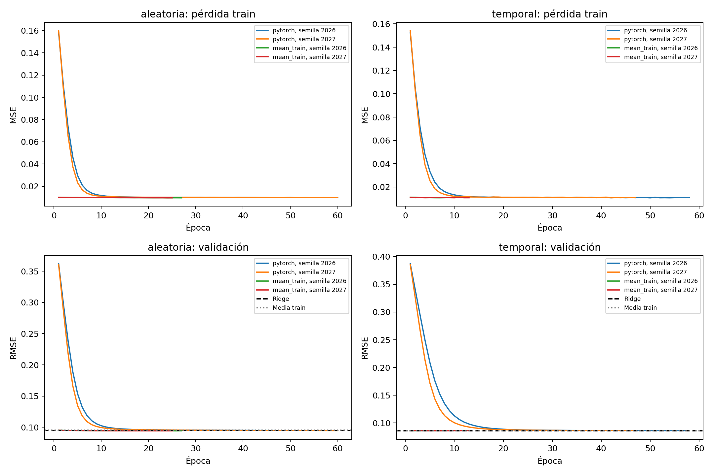
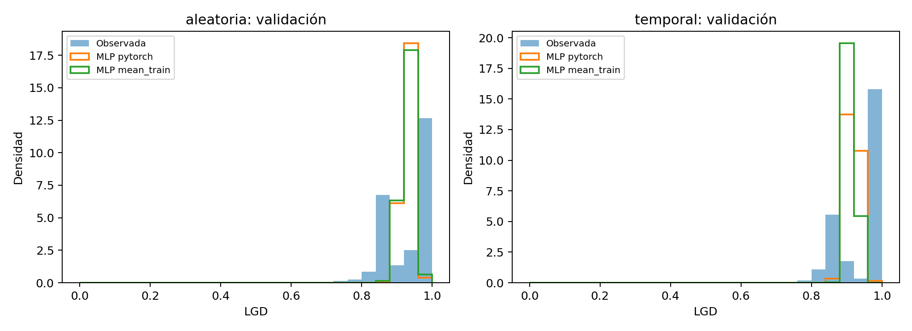

# Piloto de convergencia del MLP de LGD

## Protocolo fijado antes de ejecutar

Pregunta: ¿el MLP base aprende con entrenamiento suficiente y ayuda inicializar su salida cerca de la media de LGD del entrenamiento? No es búsqueda de hiperparámetros ni evaluación final.

| Elemento | Decisión predefinida | Motivo |
|---|---|---|
| Muestra/entradas | `castigado=True`; transformación del `models/preprocessor.joblib` existente; mismos `split_random` y `split_temporal` que Ridge | Aislar el entrenamiento del estimador y conservar comparación de filas/características. |
| Arquitectura | 99→32→1, ReLU y sigmoid | Base ya implementada; salida respeta LGD en [0,1]. |
| Pérdida/optimizador | MSE + Adam, tasa 0,001 | Alinea la pérdida con RMSE y con la predicción de media condicional esperada. |
| Inicialización | `pytorch` actual vs. `media_train`: pesos de la última capa lineal a cero y sesgo a `logit(media(y_train))` | La segunda variante inicia con salida constante igual a la media de entrenamiento. Se modifican tanto pesos como sesgo. Nunca se usa y de validación/prueba para inicializar. |
| Semillas | 2026 y 2027 por condición y partición | Emparejamiento de semillas para comparar inicializaciones con las mismas condiciones aleatorias. |
| Parada | máximo 60 épocas, paciencia 8, mínimo cambio RMSE=0,0001 | Suficiente para observar convergencia y evitar entrenamiento abierto. Se restaura el mínimo RMSE de validación. |
| Presupuesto | 8 ajustes (2 particiones × 2 inicializaciones × 2 semillas), hasta 15 minutos CPU total; CPU, dos hilos | Piloto pequeño, no las 9 configuraciones ni las 30 semillas. |
| Decisión | Solo RMSE de validación y trayectoria; además MAE, sesgo, R² y media predicha para diagnóstico | La prueba no se consulta ni calcula. No se elige arquitectura aquí. |

Se leen los baselines de validación ya publicados en `results/lgd_lineal.csv`: aleatoria Ridge RMSE=0,0947461197 y media de entrenamiento=0,0954357228; temporal Ridge=0,0858591192 y media=0,0857524383. Se recalcularán desde el CSV al ejecutar y se guardarán en el resumen del piloto.

Si una inicialización alcanza el máximo y su mejor checkpoint es la última época repetidamente, el resultado se considera truncado: se documentará una extensión exploratoria pequeña y predefinida, sin usar prueba. Si converge sin batir media/Ridge, se inspeccionarán escalas, gradientes, saturación de sigmoid, distribución y sesgo antes de sacar conclusiones.

### Enmienda exploratoria predefinida para posible truncamiento

Las dos corridas `aleatoria/pytorch` agotaron el límite inicial de 60 épocas. Antes de esta extensión se fijó repetir **solo esas dos** combinaciones, semillas 2026/2027, con el mismo modelo/optimizador/lr/batch/paciencia y máximo 90 épocas. El piloto original no guarda estado del optimizador, así que será una repetición determinista extendida desde el inicio, no una continuación exacta del estado Adam. Presupuesto adicional: 5 min CPU. Solo validación; las salidas corregidas quedan en `results/lgd_mlp_convergencia_extension_v2/` y `models/lgd_mlp_convergencia_extension_v2/`.

### Corrección de checkpoint antes de publicar

La inspección de la trayectoria mostró que la rutina inicial usaba `min_delta` para decidir tanto el reinicio de paciencia como el guardado del checkpoint. Para respetar “mejor checkpoint por RMSE”, ahora se guarda todo mínimo estricto de validación, mientras `min_delta=0,0001` solo controla el reinicio de paciencia. Repetí el piloto y la extensión desde cero con las mismas semillas/configuración en rutas `*_v2`; las salidas originales se conservan como historial, pero sus checkpoints se consideran preliminares y no canónicos. Se verificó que `epoca_mejor` coincide en las 8 corridas con el mínimo de la trayectoria JSON.

## Ejecución y artefactos

El comando guarda únicamente en `results/lgd_mlp_convergencia_piloto/` y `models/lgd_mlp_convergencia_piloto/`; ambas rutas son nuevas y el script rechaza carpetas con contenido. Registra historial por época, métricas por corrida, comparaciones con referencias, predicciones de validación, figuras, parámetros exactos, hashes y versiones. Los únicos conjuntos de los que se obtienen predicciones/métricas son entrenamiento para inicializar `media_train` y validación para parada/evaluación. El script no calcula métricas de prueba.

La etiqueta temporal todavía usa el preprocesador compartido ajustado sobre entrenamiento aleatorio. La comparación temporal conserva esa limitación, y los cambios del objetivo LGD entre periodos implican que un buen ajuste aleatorio no garantiza transporte temporal. La salida sigmoid con MSE estima una media condicional, no la masa probabilística exacta en LGD=1.

## Resultados observados

El comando principal fue:

```powershell
.\.venv\Scripts\python.exe scripts/17_piloto_convergencia_mlp_lgd.py
```

Completó 8 corridas en **94,67 s de pared / 92,15 s de entrenamiento**, frente a 900 s presupuestados. Cada red tiene 3.233 parámetros entrenables. Se guardaron métricas, predicciones de validación, ocho checkpoints, ocho trayectorias, figuras, versiones y hashes en `results/lgd_mlp_convergencia_piloto_v2/` y `models/lgd_mlp_convergencia_piloto_v2/`. No se calcularon métricas ni se usaron scores de prueba.

| Partición | Inicialización | Épocas mejor / ejecutadas (semillas 2026, 2027) | RMSE validación media ± desv. | MAE media | Sesgo medio | R² medio | LGD media predicha (observada) | Tiempo medio por corrida |
|---|---|---|---:|---:|---:|---:|---:|---:|
| Aleatoria | PyTorch | 60/60, 60/60; límite | 0,094784 ± 0,000107 | 0,072538 | −0,000797 | 0,013501 | 0,929219 (0,930016) | 19,21 s |
| Aleatoria | salida en media train | 26/27, 24/25; paciencia | **0,094325 ± 0,000022** | **0,071879** | −0,000129 | 0,023046 | 0,929887 (0,930016) | 8,36 s |
| Temporal | PyTorch | 57/58, 45/47; paciencia | 0,086193 ± 0,000091 | 0,076192 | −0,027760 | −0,128828 | 0,917391 (0,945151) | 15,29 s |
| Temporal | salida en media train | 1/9, 7/13; paciencia | **0,085739 ± 0,000039** | 0,076925 | −0,027718 | −0,116973 | 0,917433 (0,945151) | 3,23 s |

Los promedios/desviaciones usan solo las dos semillas exploratorias; no estiman con precisión la variabilidad entre entrenamientos. Criterio RMSE y parada se calcularon por separado dentro de cada partición.

Con inicialización `mean_train`, RMSE medio fue 0,000459 menor que la inicialización PyTorch en aleatoria y 0,000454 menor en temporal (alrededor de medio por ciento en cada caso). El tiempo medio también bajó de 19,21 a 8,36 s por corrida aleatoria y de 15,29 a 3,23 s temporal; parte de esa diferencia se debe a que inicia ya en una predicción constante competitiva y para antes. Es una señal favorable para incluir la alternativa, no evidencia suficiente para fijarla como única inicialización.

| Partición / baseline | RMSE validación guardado | Diferencia media MLP salida-media vs baseline |
|---|---:|---:|
| Aleatoria / Ridge | 0,094746 | MLP 0,000421 menor |
| Aleatoria / media train | 0,095436 | MLP 0,001111 menor |
| Temporal / Ridge | 0,085859 | MLP 0,000120 menor |
| Temporal / media train | 0,085752 | MLP 0,000013 menor |

Los baselines se releyeron directamente de `results/lgd_lineal.csv` en las filas de validación. La inicialización `mean_train` fija **ambos** pesos y sesgo de salida; al comenzar, toda observación recibe la media de `y_train` (0,929023 aleatoria; 0,917363 temporal). No consulta las medias de validación para formar los parámetros.

### Convergencia, diagnóstico y extensión

La pérdida de entrenamiento cae de cerca de 0,16 a aproximadamente 0,0098 (aleatoria) y de 0,15 a 0,0109 (temporal) con inicialización PyTorch; los gradientes actualizan los pesos y las salidas dejan de ser constantes. Esto, junto con RMSE que baja desde 0,36–0,39 a ~0,09, confirma que el entrenamiento/retropropagación funciona y que el RMSE alto de la demo de dos épocas **no se debía solo a una escala o pérdida mal conectada**. La salida sigmoid permanece finita y en [0,1]. La variante iniciada en media empieza con pérdida de entrenamiento cercana a 0,01, como se espera de una predicción constante próxima a la media. La pérdida train guardada por época es el promedio aritmético de los MSE de los lotes (el lote final puede ser más pequeño), mientras que RMSE de validación se calcula sobre todas sus filas.

La inicialización normal agotó el máximo inicial de 60 épocas en ambas semillas aleatorias (mejor época 54, seis épocas sin mejora antes del límite). Se fijó una repetición previa a ejecutar de esas dos corridas con máximo 90, mismas semillas y condiciones; como no se guardó estado Adam, se reiniciaron desde la semilla y no se reanudó el optimizador. Comando:

```powershell
.\.venv\Scripts\python.exe scripts/18_extender_convergencia_lgd.py
```

La extensión tomó 44,29 s de pared / 42,62 s de entrenamiento. Paró por paciencia en épocas 62 y 70; esos son también los mínimos estrictos de validación guardados. RMSE fue 0,094840 y 0,094618 (media 0,094729), con ganancias pequeñas frente a la corrida hasta 60. Esto indica que el entrenamiento alcanza una meseta bajo la condición actual; no se justifica ampliar más el límite para esas mismas corridas.

La media de validación del objetivo cambia de 0,930016 (aleatoria) a 0,945151 (temporal), y la masa observada exactamente en LGD=1 aumenta de 45,96 % a 62,72 %. Así, la red temporal predice media ~0,9173 y tiene sesgo ~−0,0278: aun con salida constante sensata para la distribución de entrenamiento, subestima el periodo de validación. Una inicialización no puede reparar este cambio temporal. Además, el preprocesador compartido continúa ajustado con entrenamiento aleatorio y pudo incorporar filas temporales de validación; la métrica temporal es provisional bajo esa limitación conocida.

La red supera claramente el RMSE de la demo de dos épocas: aleatoria 0,297763→0,094309 (68,3 % menor con semilla 2026 y salida iniciada en media; la extensión estándar logra 0,094840/0,094618); temporal 0,340829→0,085712 (74,9 % menor con semilla 2026/media train). La comparación de semilla/inicialización debe leerse junto con las tablas anteriores, no como selección final. La media de las dos semillas de inicialización constante logra un RMSE apenas mejor que Ridge en aleatoria; en temporal es prácticamente idéntica a predecir la media de entrenamiento y no vence sustantivamente la referencia.

El resultado probabilístico puntual no reproduce la distribución completa. En validación aleatoria, 45,96 % de los objetivos son exactamente 1; en temporal, 62,72 %. Las predicciones se concentran alrededor de su media (desviación aproximada 0,015 aleatoria y 0,006 temporal con inicialización `mean_train`) y casi ninguna es mayor que 0,99; sigmoid + MSE aprende una media condicional, no un modelo explícito de la masa puntual en 1. Una predicción casi constante puede optimizar RMSE, pero no representa el pico individual en 1 ni aporta buena segmentación por préstamo.





## Conclusión operativa

El esqueleto **sí está listo técnicamente** para la búsqueda de nueve configuraciones: los gradientes y la salida funcionan, la parada por validación restaura el mejor estado y el coste medido queda muy por debajo del presupuesto previo de 30 minutos. Recomiendo antes de iniciar esa búsqueda incorporar la inicialización `mean_train` como una alternativa **explícita y emparejada en la configuración base de cada partición**, junto a inicialización PyTorch, y seleccionar esa decisión solo con la validación correspondiente. El piloto sugiere menos tiempo y RMSE algo menor en aleatoria, pero ninguna ventaja apreciable frente a la media temporal. No convertiría aún la inicialización en un cambio irrevocable para todas las variantes: solo hay dos semillas, los márgenes aleatorios son pequeños y el objetivo temporal cambia. Si el presupuesto de búsqueda se conserva en 30 minutos, hay margen observado para este contraste; registrar y verificar el nuevo presupuesto al crear el comando de búsqueda.

Este trabajo no ejecutó la búsqueda de nueve configuraciones ni las 30 semillas finales por partición, no produjo resultados finales y no evaluó prueba. Los artefactos del demo anterior permanecen intactos. El objetivo temporal y el posible efecto del ajuste aleatorio del preprocesador siguen como límites metodológicos.
