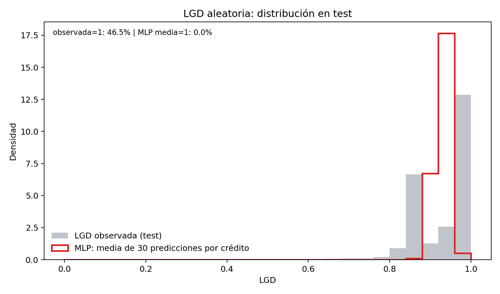
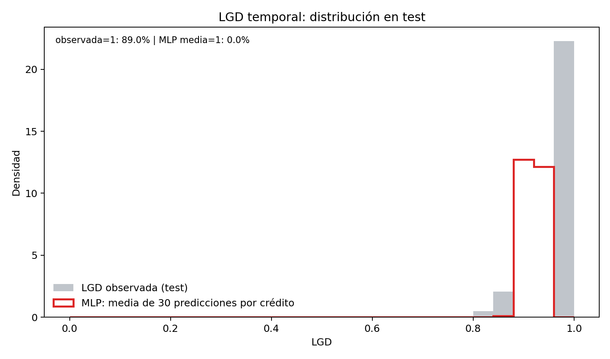

# Fase final MLP de LGD: 30 semillas

## Congelamiento previo

La búsqueda previa, sus diez hipótesis, los cambios aislados respecto de la base y el resultado/juicio de utilidad de cada variante están detallados en [`mlp_lgd_busqueda.md`](mlp_lgd_busqueda.md). Esa comparación seleccionó por separado el menor promedio de RMSE de validación dentro de cada partición; prueba no intervino.

Antes de entrenar, el ejecutor final verifica los diez hashes de entrada que registra `results/lgd_mlp_search_v1/resumen_busqueda.json`; los diez coincidieron con el checkout. Verifica asimismo la selección contra los candidatos de `configs/mlp_lgd.yaml`, y recalcula el ganador por RMSE medio usando `metricas_por_corrida.csv`. Se congela:

| Partición | Configuración | Inicialización |
|---|---|---|
| Aleatoria | 99→32→1, ReLU, sigmoid, MSE, Adam, lr=0,001, sin dropout ni weight decay | `mean_train` |
| Temporal | 99→32→1, ReLU, sigmoid, MSE, Adam, lr=0,003, sin dropout ni weight decay | `mean_train` |

En cada partición se usan las semillas 0–29, 30 corridas. Lote 2.048, máximo 100 épocas, paciencia 12, `min_delta=0,00001`; el checkpoint es el mínimo estricto de RMSE de validación y `min_delta` solo controla paciencia. Estas opciones son las de búsqueda; la prueba no elige época, pesos ni configuración. No se cambia el código/artefacto de búsqueda: `scripts/21_entrenar_mlp_lgd_final.py` es un ejecutor separado.

La red recibe 99 columnas transformadas compartidas con Ridge. Su bloque entrenable es 99→32 con ReLU y luego 32→1 con sigmoide, para restringir la predicción al intervalo [0,1]. Se minimiza MSE: bajo esta pérdida, la salida representa una media condicional acotada, no una distribución que pueda asignar probabilidad puntual a LGD=1. `mean_train` inicializa la capa de salida con pesos cero y sesgo `logit(media_LGD_train)` de la partición correspondiente; la media proviene exclusivamente del entrenamiento. Así todas las características comienzan prediciendo una constante aprendida del train, y el resto de la red puede ajustar desviaciones. El conteo es `(99×32 + 32) + (32×1 + 1) = 3.233` parámetros. Adam actualiza los pesos por minibatches de 2.048; early stopping conserva el checkpoint con menor RMSE de validación, con máximo 100 épocas, paciencia 12 y `min_delta=10⁻⁵`. Las 30 semillas describen variación por inicialización/orden de minibatches, no 30 configuraciones distintas.

La muestra es `castigado=True`; se transforma con el preprocesador guardado, 29 columnas originales→99 características, y las máscaras existentes. Se comprueba igualdad de IDs Ridge/MLP en entrenamiento, validación y prueba. El ajuste de pesos y parada recibe solo entrenamiento y validación. Tras congelar y guardar los 60 estados, se calculan las métricas de validación y prueba. Ridge y la referencia constante usan las mismas filas.

Preflight verificado antes de esta fase: los hashes de datos LGD, preprocesador, métricas Ridge, predicciones Ridge, verificación de datos, `src/mlp_lgd.py`, `src/metricas_lgd.py`, `scripts/19_buscar_mlp_lgd.py` y `configs/mlp_lgd.yaml` coinciden con la búsqueda. Además se guardan hashes de la búsqueda ya producida (resumen, métricas por semilla, resumen de candidatos, predicciones, trayectorias) como contrato de esta fase.

Comando reproducible, en directorios nuevos:

```powershell
.\.venv\Scripts\python.exe scripts/21_entrenar_mlp_lgd_final.py --modo final --preflight-only
.\.venv\Scripts\python.exe scripts/21_entrenar_mlp_lgd_final.py --modo final
```

```bash
python scripts/21_entrenar_mlp_lgd_final.py --modo final --preflight-only
python scripts/21_entrenar_mlp_lgd_final.py --modo final
```

El comando se niega a sobrescribir `models/lgd_mlp_final_v2/` o `results/lgd_mlp_final_v2/`. Para otra ejecución se debe indicar otro par de directorios con `--output-dir` y `--models-dir`.

## Nota de la primera ejecución

La primera pasada guardó 60 checkpoints en `models/lgd_mlp_final_v1/`, pero falló al cotejar la etiqueta Ridge con la del parquet por una tolerancia menor que el redondeo de float32 usado por torch. Se detuvo antes de escribir métricas o calcular prueba; los checkpoints v1 no se presentan como resultados finales porque no conservaron tiempos por semilla en su metadata. Se preservan intactos. La corrección aplica `atol=1e-6` solo a la igualdad numérica de etiquetas observadas alineadas por ID, registra el tiempo en cada checkpoint y repite en rutas v2. No altera la definición del modelo, selección, particiones ni criterio.

## Resultados finales v2

El preflight pasó antes de entrenar: los diez hashes de entrada de la búsqueda coinciden, los hashes de los cinco artefactos de búsqueda se registraron y la selección recalculada por RMSE medio coincide con los dos ganadores guardados. Las 60 corridas (30 semillas en cada partición) pararon por paciencia; ninguna llegó al límite de 100 épocas. Se guardaron 60 modelos y se evaluaron validación/prueba después de congelar todos los checkpoints. Comando:

```powershell
.\.venv\Scripts\python.exe scripts/21_entrenar_mlp_lgd_final.py --modo final
```

| Partición / conjunto | MAE media ± DE | RMSE media ± DE | Sesgo media ± DE | R² media ± DE |
|---|---:|---:|---:|---:|
| Aleatoria / validación | 0,072003 ± 0,000133 | 0,094377 ± 0,000032 | −0,000550 ± 0,000400 | 0,021968 ± 0,000665 |
| Aleatoria / prueba | 0,071284 ± 0,000110 | 0,092985 ± 0,000056 | −0,002925 ± 0,000401 | 0,016493 ± 0,001178 |
| Temporal / validación | 0,075655 ± 0,000468 | 0,085311 ± 0,000217 | −0,026063 ± 0,000966 | −0,105857 ± 0,005621 |
| Temporal / prueba | 0,082304 ± 0,000772 | 0,095806 ± 0,000757 | −0,061985 ± 0,000938 | −0,838097 ± 0,028998 |

Los mínimos/máximos y las semillas que los obtuvieron están en `resumen_metricas_30_semillas.csv`, para cada métrica, partición y conjunto. Para sesgo, “mejor/peor” significa menor/mayor valor absoluto; también se conservan mínimo y máximo con signo. En prueba aleatoria, RMSE varió de 0,092883 (semilla 14) a 0,093114 (15); en temporal, de 0,093799 (5) a 0,097062 (26). Los extremos temporales evidencian variabilidad relevante entre semillas.

### Comparación en las mismas filas

| Partición / conjunto | Modelo | MAE | RMSE | Sesgo | R² |
|---|---|---:|---:|---:|---:|
| Aleatoria / prueba | MLP (promedio de métricas de 30 semillas) | **0,071284** | **0,092985** | −0,002925 | **0,016493** |
| Aleatoria / prueba | Ridge | 0,071973 | 0,093120 | −0,003157 | 0,013630 |
| Aleatoria / prueba | Media de train | 0,072542 | 0,093810 | −0,003024 | −0,001040 |
| Temporal / prueba | MLP (promedio de métricas de 30 semillas) | **0,082304** | 0,095806 | **−0,061985** | −0,838097 |
| Temporal / prueba | Ridge | 0,084295 | **0,095254** | −0,063850 | −0,816891 |
| Temporal / prueba | Media de train | 0,083958 | **0,094929** | −0,063384 | **−0,804489** |

En aleatoria, la MLP mejora a Ridge y a la media en ambas pérdidas: frente a Ridge, MAE baja 0,000689 y RMSE 0,000135; frente a la media, MAE baja 0,001258 y RMSE 0,000825. Son mejoras pequeñas, aunque las 30 semillas muestran poca dispersión. En temporal, MLP mejora MAE frente a Ridge/media en prueba (0,001991/0,001654) y su sesgo medio absoluto es algo menor, pero **pierde en RMSE y R²**: su RMSE 0,095806 supera 0,095254 de Ridge y 0,094929 de la constante; todos los R² son muy negativos. Por tanto, la MLP no domina las referencias temporalmente.

La búsqueda exploró **10 configuraciones / 40 ajustes**, con 515,35 s pared y 510,74 s de entrenamiento. La fase final v2 tomó 525,27 s pared y 521,37 s de entrenamiento; suma búsqueda+final: **1.040,62 s pared (17 min 20,6 s) y 1.032,11 s de entrenamiento**. La extensión diagnóstica de inicialización PyTorch se midió aparte (105,11 s pared, 102,92 s entrenamiento); no está dentro de esa suma. La primera fase final v1 produjo 60 checkpoints pero falló antes de guardar métricas y tiempos por semilla debido a la tolerancia float32; sus duraciones individuales no se persistieron y se excluyen de los totales publicados para no estimarlas. Los modelos v1 se conservaron, no son los canónicos.

Cada MLP tiene **3.233 parámetros**. La fase final entrenó 340,33 s en aleatoria (promedio 11,34 s/semilla) y 181,04 s en temporal (promedio 6,03 s/semilla). Las referencias deterministas no tienen variación entre semillas y la media de train no requiere optimización; el Ridge guardó tiempos de búsqueda de ~0,244 s aleatoria y ~0,391 s temporal. La MLP paga, por tanto, mayor coste e interpretabilidad más baja por mejoras marginales en aleatoria y una comparación mixta en temporal.

### Distribuciones y deriva temporal

Las figuras usan el conjunto de prueba, ya evaluado tras congelar los modelos, y comparan objetivo con la **media de las 30 predicciones de cada crédito**. En cambio, la tabla de métricas anterior informa la **media de las 30 métricas calculadas por separado para cada semilla**. Son resúmenes distintos: la métrica de la predicción promedio por crédito no es, en general, igual al promedio de las métricas individuales. La tabla de cuantiles incluye además validación, desviación, extremos y fracciones exactamente 0/1.

| Partición / test | Serie | Media | Desv. | P10 | P50 | P90 | P99 | Proporción exactamente 1 |
|---|---|---:|---:|---:|---:|---:|---:|---:|
| Aleatoria | Observada | 0,932047 | 0,093768 | 0,851231 | 0,991108 | 1,000000 | 1,000000 | 46,49 % |
| Aleatoria | Predicción MLP media | 0,929122 | 0,015995 | 0,909135 | 0,929767 | 0,949296 | 0,962972 | 0 % |
| Temporal | Observada | 0,980747 | 0,070680 | 0,854584 | 1,000000 | 1,000000 | 1,000000 | 88,97 % |
| Temporal | Predicción MLP media | 0,918762 | 0,019598 | 0,902816 | 0,919501 | 0,934632 | 0,945313 | 0 % |





Sigmoide+MSE entrega una media condicional acotada; no modela explícitamente la masa puntual en LGD=1, por lo que no reproduce el pico observado. La transición temporal es particularmente fuerte: la media observada castigada pasa de 0,930 en validación aleatoria a 0,945 en validación temporal y 0,981 en prueba temporal; la masa exactamente en uno pasa de 46,49 % en prueba aleatoria a 88,97 % temporal. La MLP conserva predicciones en torno a 0,919 en la prueba temporal, con sesgo −0,062. Esto no se debe presentar como defecto exclusivamente arquitectónico: hay cambio de población/resultado y posible censura/maduración.

Se mantiene la limitación documentada: el preprocesador compartido se ajustó con entrenamiento aleatorio y pudo incorporar filas de validación/prueba temporal. La selección temporal y sus métricas no eliminan esa limitación ni prueban ausencia de fuga. La fase final deja una comparación transparente bajo los artefactos acordados, no una validación temporal corregida.

El equipo comunicó que evaluó una alternativa y decidió conservar el preprocesador actual porque la mejora no justificaba incorporarla. En este repositorio no se encontró la evaluación, el criterio, los datos ni las métricas; por ello no se atribuyen números ni se afirma que la alternativa haya sido reproducida. La decisión permite continuar con los artefactos acordados, pero no demuestra que el preprocesador esté libre de solapamiento temporal.

También hay una brecha de reproducibilidad heredada de Ridge: `src/lgd_lineal.py` define por defecto alphas `[0.01, 0.1, 1, 10, 100, 1000]`, mientras `results/lgd_lineal_resumen.json` indica ocho configuraciones y un alpha temporal seleccionado de 100.000. No consta en los artefactos la lista explícita usada. No se cambiaron el código ni los resultados de C; la comparación aquí conserva esas referencias guardadas y deja la discrepancia señalada.

### Artefactos de la fase

Los 60 checkpoints con semilla, parámetros, época, parada, tiempo, contrato de 99 entradas, hashes y configuración están en `models/lgd_mlp_final_v2/`. Los CSV/parquet/JSON y figuras están en `results/lgd_mlp_final_v2/`, incluidos `corridas_modelos.csv`, `metricas_por_semilla_validacion_prueba.csv`, `resumen_metricas_30_semillas.csv`, `metricas_baselines.csv`, `comparacion_mlp_ridge_media.csv`, `cuantiles_y_masa_en_uno.csv`, `tiempos_por_particion.csv` y `resumen_final.json`. Los artefactos anteriores, incluida la pasada v1 incompleta, siguen intactos.

## Conclusión

La MLP aporta una ganancia pequeña frente a Ridge y a la media en la partición aleatoria, con baja variación entre semillas pero mucho más coste, 3.233 parámetros y menor interpretabilidad. En temporal aporta menor MAE, pero no menor RMSE ni mejor R² en prueba; además subestima con fuerza la LGD de prueba. Dado que la salida es una media acotada y el conjunto temporal contiene una masa muy alta en uno, no afirmaría que la MLP sea un modelo de LGD superior en general. La conclusión defendible es: ligera mejora aleatoria, resultado temporal mixto y limitado por deriva y preprocesamiento.
